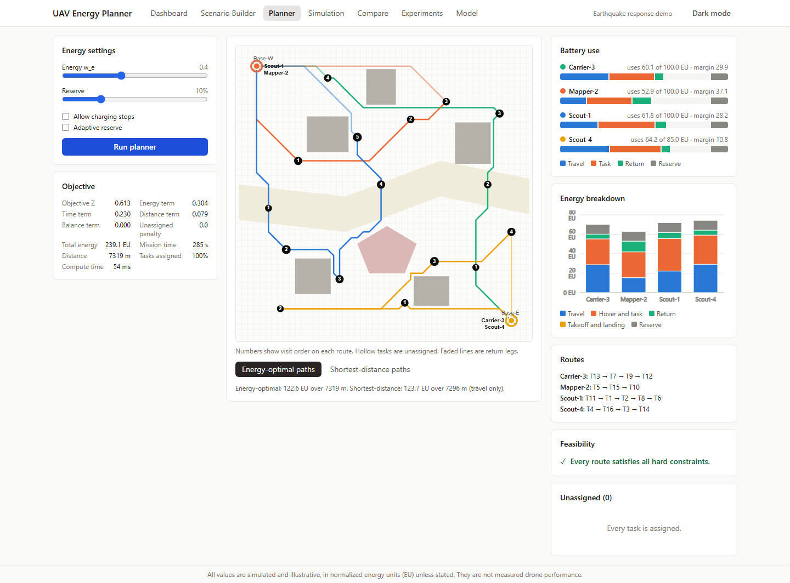
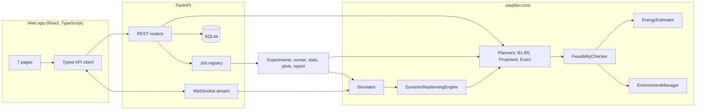

# Optimizing Routing, Task Allocation, and Energy Management in Collaborative UAV Systems

Energy-aware route planning, battery-feasibility checks and dynamic energy replanning for
multi-UAV missions: an optimization core, a mission simulator, an experiment runner, a REST/WebSocket API and a web app.

> All values are **simulated and illustrative**, in normalized energy units (EU) unless stated.
> They are not measured drone performance.



Several UAVs with limited batteries must complete tasks spread across a map. The planner decides
which UAV does each task, in what order and along which path, and checks that every route is
energy-feasible: route energy + task energy + return energy + reserve ≤ battery.

**Core idea:** treat energy as the deciding constraint. Every route must get the UAV home with its
reserve intact, and each insertion is judged by its effect on the whole route and battery. When the
mission changes or a battery runs low, repair the affected routes first and widen the scope only
when needed.

Energy management features:

- One `EnergyEstimator` for all energy maths, in normalized (EU) or physical (J) mode
- Total and prefix battery checks, return to the nearest station, and a configurable reserve
- Energy-weighted A*, with a map toggle comparing energy-optimal and shortest-distance paths
- Planned vs actual energy per UAV, margin alerts, seeded energy noise and battery-drop replanning
- Optional charging stops, an adaptive reserve and early return-to-home (all off by default)

The research question is *whether* this energy-aware planning helps. Experiment reports include a section
on where it does not.

## Quick start

With Docker:

```bash
docker compose up --build
```

The web app is at <http://localhost:5173> and the API docs at <http://localhost:8000/docs>. On the
Dashboard, press **Load earthquake demo**, then **Run planner**.

For local development you need Python 3.12 with [uv](https://docs.astral.sh/uv/), and Node 22 or later.
Each `python scripts/dev.py <target>` also works as `make <target>`.

```bash
python scripts/dev.py setup       # install dependencies
python scripts/dev.py run-api     # API on :8000
python scripts/dev.py run-web     # web app on :5173
python scripts/dev.py test        # backend and frontend tests
python scripts/dev.py lint        # ruff, mypy --strict, tsc
```

A minimal Streamlit dashboard is also available. From `backend/`:
`uv run --extra streamlit streamlit run ../apps/streamlit_app.py`.

## Command line

```bash
cd backend
uv run uavplan plan --scenario DEMO --algorithm integrated
uv run uavplan simulate --scenario E --algorithm integrated --noise 0.05
uv run uavplan experiment --scenarios A,B,C,D,E --algorithms all --seeds 30 --ablations --report
```

## Architecture



`EnergyEstimator` is the only code that computes energy. Every plan is judged by the same
`FeasibilityChecker`, and the same scenario, seed and algorithm give identical output apart from
measured compute time.

## Algorithms

| Name | Label | Approach |
|---|---|---|
| `nearest` | B1 | Closest capable UAV, with no energy check while planning |
| `greedy_energy` | B2 | Nearest UAV that can still do the task and return; appends only |
| `independent` | B3 | Balanced allocation, then routing, then drops tasks until feasible |
| `integrated` | **Proposed** | Feasibility-aware insertion, repair move, local search within and between routes |
| `ortools_vrp` | B4 | Multi-depot VRP with energy and time dimensions, guided local search |
| `genetic` | B5 | Giant-tour genetic algorithm with a feasibility-aware decoder |
| `exact_cpsat` | Exact | CP-SAT model for small instances, used to measure optimality gaps |

## What the experiments found

From a 30-seed run of Scenarios A–G, on simulated missions only (mean values; significance is a
paired Wilcoxon test with Holm correction at p < 0.05):

- **Against B1–B3:** the proposed method completes significantly more tasks in Scenarios B–E
  (for example 91.1% against 75.3%, 78.7% and 79.7% in B). It uses significantly less energy per
  completed task in all of A–E. In A, the small scenario, its completion rate is not significantly
  different from B1 or B3.
- **Against the genetic algorithm:** significantly more tasks in B and E, and no significant
  difference in A, C or D.
- **Against OR-Tools: the proposed method loses on quality.** OR-Tools completes significantly more
  tasks in B, C and D (92.3% against 91.1% in B) and uses less energy per task in B–E. It also took
  about 25–100 times longer to plan (3.6–6.7 s against 0.05–0.3 s).
- **Optimality:** on 30 Scenario A instances, all proven optimal by CP-SAT, the proposed method's
  gap in `Z` has median 0.00%, mean 0.36% and maximum 6.24%.
- **Replanning:** in D, mandatory-task completion is 50.8% with no replanning, 78.2% with local
  repair only and 97.5% with local-then-global. That matches always-global replanning, at about
  two-thirds of its replanning time (46 ms against 69 ms).
- **Ablations:** inter-route search has the clearest effect, improving `Z` significantly in every
  scenario. Removing the energy term from the cost made little difference (significant only for
  energy per task in A), so energy matters here mainly as a hard constraint.
- **Reserve:** a 10% reserve does not fully absorb large estimation errors. At noise σ = 0.2, about
  91% of the proposed method's UAVs landed with the reserve intact, similar to B3 (92%).

Run the full protocol to regenerate these numbers. Every comparison the proposed method did not
win is listed in the "Where the integrated method does not help" section of `REPORT.md`.

## Reproducing the results

```bash
python scripts/dev.py experiments-quick   # 5 seeds, A-E
python scripts/dev.py experiments-full    # 30 seeds, A-G
```

Each run writes `raw.csv`, `summary.csv`, `stats.csv`, figures and `REPORT.md` to `results/<name>/`.
Runs are resumable. `results/sample/` holds a committed quick run. The protocol is in
[docs/EXPERIMENTS.md](docs/EXPERIMENTS.md).

## Documentation

| Document | Contents |
|---|---|
| [MODEL.md](docs/MODEL.md) | The mathematical model, matching the code |
| [ALGORITHMS.md](docs/ALGORITHMS.md) | Pseudocode and complexity |
| [EXPERIMENTS.md](docs/EXPERIMENTS.md) | Protocol, scenarios, metrics and statistics |
| [USER_GUIDE.md](docs/USER_GUIDE.md) | How to use the web app |
| [API.md](docs/API.md) | REST and WebSocket reference |
| [LIMITATIONS.md](docs/LIMITATIONS.md) | What this does not do |
| [DECISIONS.md](docs/DECISIONS.md) | Choices made where the spec was open |
| [FINAL_CHECKLIST.md](docs/FINAL_CHECKLIST.md) | Each proposal item traced to code, test and evidence |
