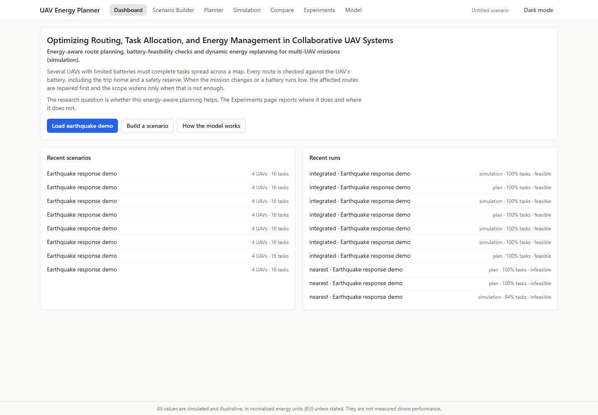
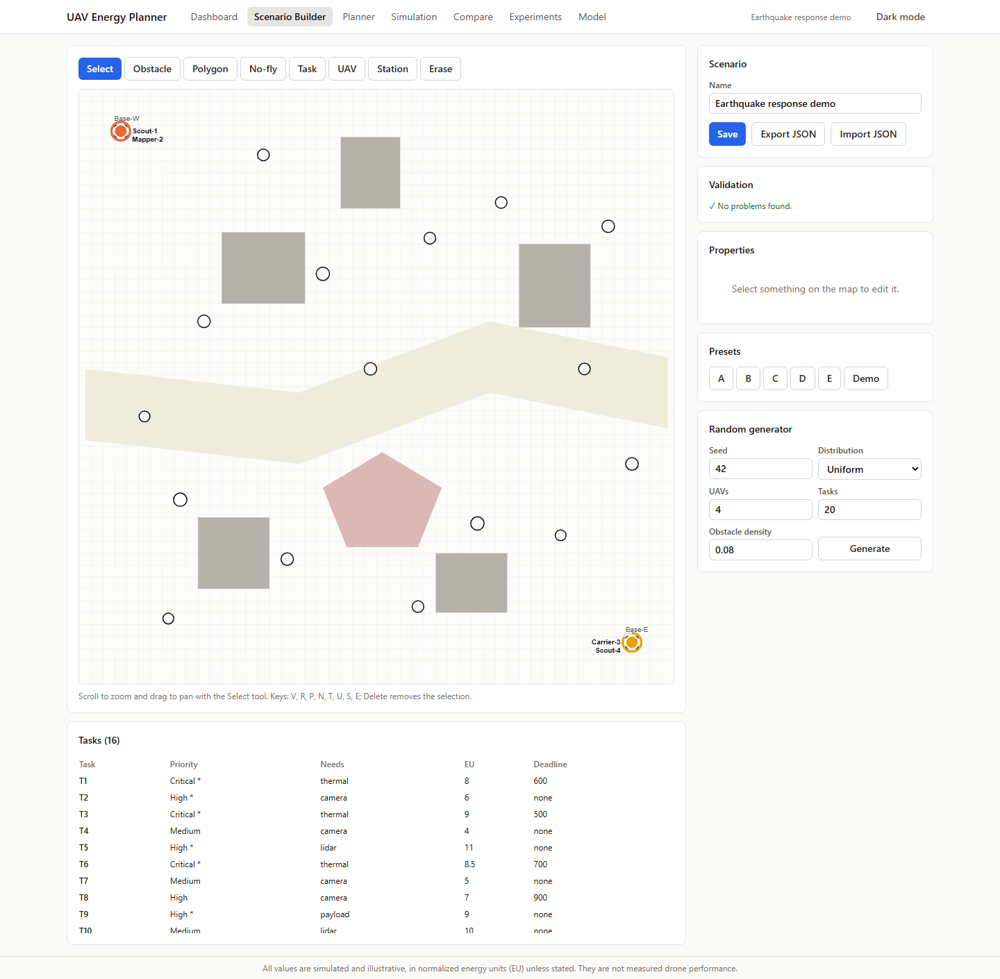
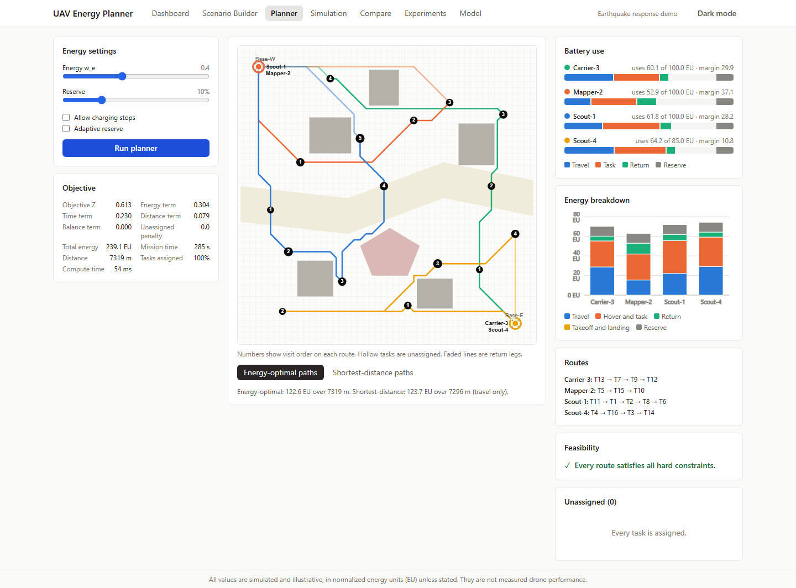
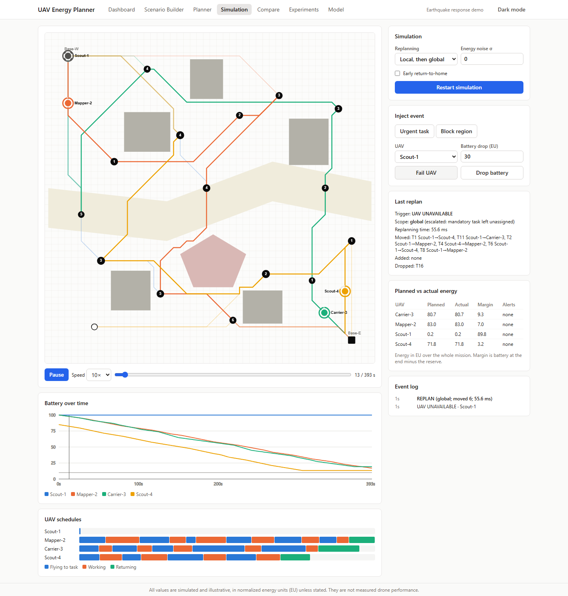
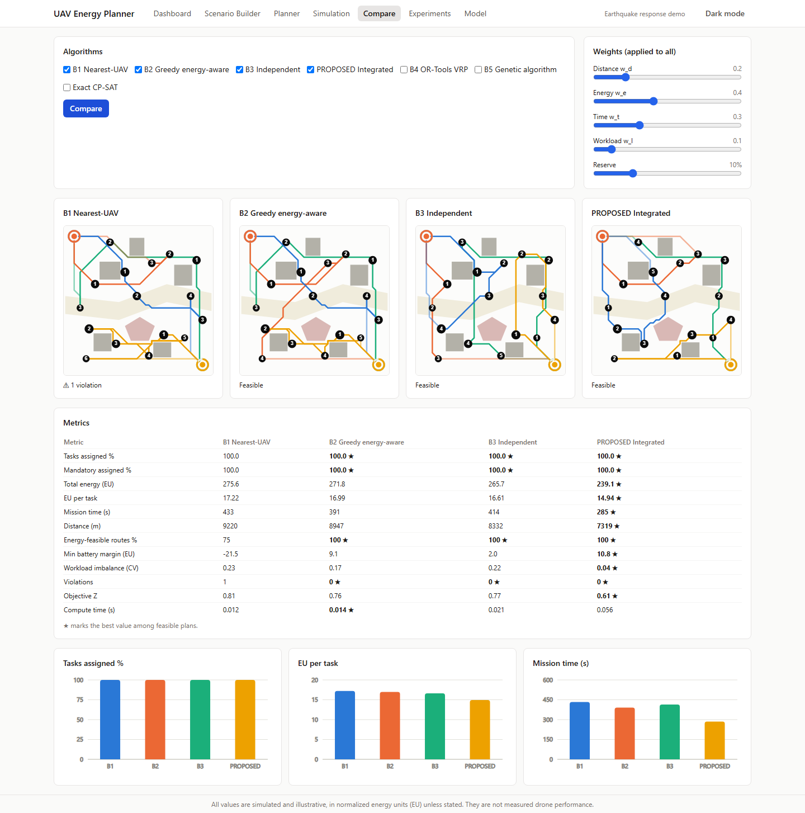
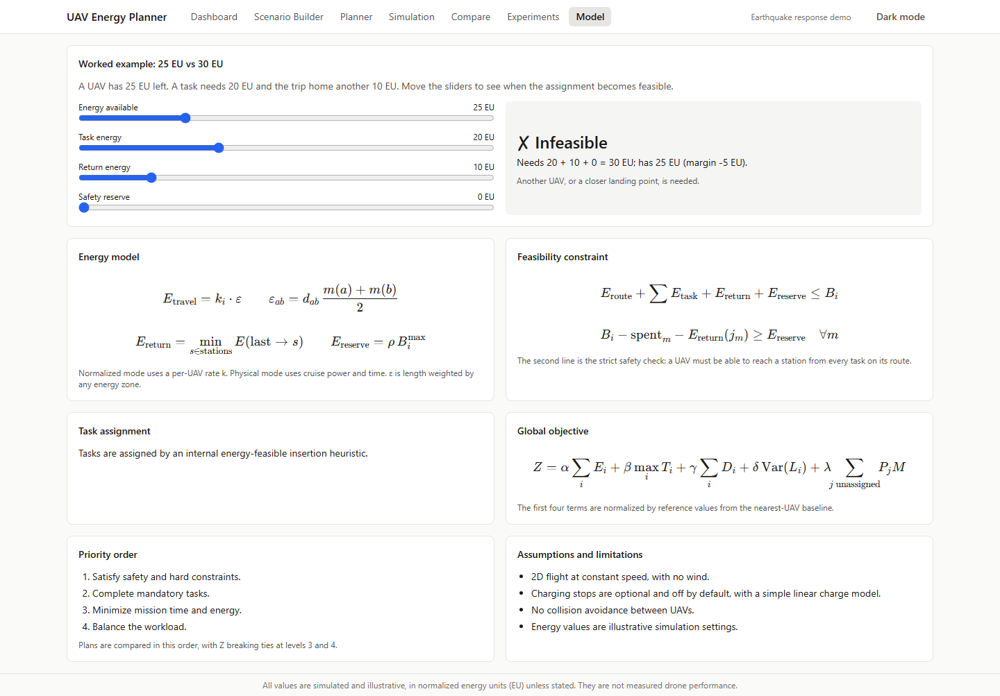

# Optimizing Routing, Task Allocation, and Energy Management in Collaborative UAV Systems: User guide

All values in the app are simulated and illustrative, in normalized energy units (EU).

## A five-minute demo

1. On the **Dashboard**, press **Load earthquake demo**. This opens the Planner.
2. Press **Run planner**. Routes appear on the map with numbered visit order, and each UAV gets
   a battery bar.
3. Raise the **Reserve** slider and run it again to see tasks drop out as the energy budget
   tightens. The Feasibility and Unassigned panels explain why.
4. Open **Simulation**. Press **Start simulation**, then **Play**.
5. While it plays, choose a UAV and press **Fail UAV**. The old route fades, the new route
   appears, and **Last replan** shows what moved and how long it took.

## Scenario Builder

| Tool | Key | Use |
|---|---|---|
| Select | V | Click to select; scroll to zoom; drag to pan |
| Obstacle | R | Drag a rectangle |
| Polygon | P | Click corners; double-click to finish |
| No-fly | N | Drag a rectangle |
| Task | T | Click to place |
| UAV | U | Click to place |
| Station | S | Click to place |
| Erase | E | Click an item to remove it |

Delete removes the current selection, and Escape cancels a drawing. The **Properties** panel
edits the selected item. **Validation** updates as you work, and the server repeats the full
check when you save. You can load presets A–E or the Demo, generate a random scenario from a
seed, and import or export JSON.

A scenario needs at least one station and one UAV. To edit a region as a high-energy zone,
select it and change its kind in Properties.

## Planner

Adjust the energy weight `w_e` and the reserve, then run it. Two options change how energy is budgeted:

- **Allow charging stops** tries a charging stop before dropping a task.
- **Adaptive reserve** holds back more energy while more of the route is still ahead.

After a run, the toggle under the map switches between **Energy-optimal** and **Shortest-distance**
paths and shows the energy and distance of each. The **Energy breakdown** chart stacks travel, hover
and task, return, takeoff and landing, and reserve for each UAV.

- **Battery use** splits each UAV's energy into travel, task, return and reserve.
- **Feasibility** lists every violation. Clicking one highlights it.
- **Unassigned** gives the reason for each task left out.
- **Objective** shows the terms of `Z` and the compute time.

## Simulation

Pick a replanning mode and optional energy noise, then start. **Early return-to-home** makes a UAV
abandon its route when actual energy no longer covers the trip home and the reserve; its remaining
tasks are replanned. **Planned vs actual energy** compares both per UAV and flags margin alerts.
 Use play, pause, speed and the
seek bar to control playback. Events you can inject:

| Event | How |
|---|---|
| Urgent task | Press **Urgent task**, then click the map |
| Blocked region | Press **Block region**, then drag on the map |
| UAV failure | Choose a UAV and press **Fail UAV** |
| Battery drop | Choose a UAV and amount, then press **Drop battery** |

Injecting an event re-runs the deterministic mission from the start with that event added, so
everything before the event stays the same.

## Compare

Run several algorithms on the current scenario with the same weights. Stars in the table mark
the best value among **feasible** plans. An infeasible plan cannot win a metric.

## Experiments

Choose scenarios, algorithms, seeds and whether to include ablations, then press **Launch**.
When the batch finishes, its results open below:

- **Summary:** per-algorithm statistics and a box plot.
- **Significance:** Holm-corrected p-values, effect size and win/tie/loss counts.
- **Pareto:** energy against mission time across the weight sweep.
- **Figures:** the report figures.
- **Report:** the generated `REPORT.md`, including "Where the integrated method does not help".

**Download all** gives a zip of the CSV files, figures and report. Use at least 6 seeds for
p < 0.05 to be reachable at all, and 30 for the full protocol.

## Model

The equations behind the planner, and the interactive 25 EU vs 30 EU feasibility example from
the proposal.
