# Experiment report

> All values are **simulated and illustrative**, in normalized energy units (EU) unless stated. They are not measured drone performance.

Runs: 335. Seeds per configuration: 5. Every algorithm receives the same scenario
instances and event sequences. In D and E each baseline re-runs itself from the current state
after an event, while the proposed method repairs locally and escalates only when needed.

Metrics come from the simulated execution. Means are shown with ± one standard deviation.
The B-series labels are the baselines defined in `docs/ALGORITHMS.md`.

## 1. Results by scenario

### Scenario A

| Algorithm | Tasks done % | Mandatory % | EU per task | Mission time s | Safe landing % | Plan feasible % | Plan time s |
|---|---|---|---|---|---|---|---|
| B1 Nearest-UAV | 90.0 ± 14.1 | 100.0 ± 0.0 | 21.28 ± 2.18 | 429 ± 47 | 73 ± 25 | 40 ± 55 | 0.008 ± 0.001 |
| B2 Greedy energy-aware | 88.0 ± 13.0 | 100.0 ± 0.0 | 22.20 ± 3.02 | 385 ± 7 | 100 ± 0 | 100 ± 0 | 0.009 ± 0.001 |
| B3 Independent | 92.0 ± 11.0 | 100.0 ± 0.0 | 21.17 ± 3.39 | 345 ± 30 | 100 ± 0 | 100 ± 0 | 0.010 ± 0.001 |
| **PROPOSED Integrated** | 94.0 ± 8.9 | 100.0 ± 0.0 | 19.87 ± 2.30 | 337 ± 71 | 100 ± 0 | 100 ± 0 | 0.018 ± 0.004 |
| B4 OR-Tools VRP | 94.0 ± 8.9 | 100.0 ± 0.0 | 19.16 ± 1.39 | 336 ± 69 | 100 ± 0 | 100 ± 0 | 2.368 ± 0.635 |
| B5 Genetic algorithm | 96.0 ± 5.5 | 100.0 ± 0.0 | 20.14 ± 2.16 | 324 ± 45 | 100 ± 0 | 100 ± 0 | 0.130 ± 0.012 |
| Exact CP-SAT | 96.0 ± 5.5 | 100.0 ± 0.0 | 19.43 ± 2.28 | 325 ± 58 | 100 ± 0 | 100 ± 0 | 5.268 ± 1.090 |

### Scenario B

| Algorithm | Tasks done % | Mandatory % | EU per task | Mission time s | Safe landing % | Plan feasible % | Plan time s |
|---|---|---|---|---|---|---|---|
| B1 Nearest-UAV | 72.0 ± 8.7 | 97.1 ± 6.4 | 18.12 ± 1.53 | 474 ± 8 | 40 ± 0 | 0 ± 0 | 0.037 ± 0.032 |
| B2 Greedy energy-aware | 78.7 ± 6.9 | 97.1 ± 6.4 | 16.70 ± 0.91 | 403 ± 17 | 100 ± 0 | 100 ± 0 | 0.039 ± 0.019 |
| B3 Independent | 76.7 ± 8.5 | 100.0 ± 0.0 | 16.50 ± 1.20 | 391 ± 16 | 100 ± 0 | 100 ± 0 | 0.069 ± 0.018 |
| **PROPOSED Integrated** | 89.3 ± 6.0 | 100.0 ± 0.0 | 14.85 ± 0.61 | 391 ± 36 | 100 ± 0 | 100 ± 0 | 0.318 ± 0.094 |
| B4 OR-Tools VRP | 92.0 ± 5.6 | 100.0 ± 0.0 | 14.51 ± 0.52 | 385 ± 34 | 100 ± 0 | 100 ± 0 | 6.675 ± 1.180 |
| B5 Genetic algorithm | 87.3 ± 6.4 | 100.0 ± 0.0 | 15.86 ± 0.50 | 401 ± 19 | 100 ± 0 | 100 ± 0 | 1.274 ± 0.238 |

### Scenario C

| Algorithm | Tasks done % | Mandatory % | EU per task | Mission time s | Safe landing % | Plan feasible % | Plan time s |
|---|---|---|---|---|---|---|---|
| B1 Nearest-UAV | 61.0 ± 9.6 | 87.0 ± 12.0 | 19.18 ± 1.79 | 327 ± 30 | 35 ± 22 | 0 ± 0 | 0.012 ± 0.001 |
| B2 Greedy energy-aware | 60.0 ± 7.9 | 79.7 ± 14.5 | 16.95 ± 1.73 | 332 ± 45 | 100 ± 0 | 100 ± 0 | 0.019 ± 0.007 |
| B3 Independent | 48.0 ± 14.8 | 83.0 ± 17.2 | 18.91 ± 3.50 | 292 ± 73 | 100 ± 0 | 100 ± 0 | 0.025 ± 0.006 |
| **PROPOSED Integrated** | 65.0 ± 12.7 | 92.0 ± 11.0 | 16.37 ± 1.39 | 325 ± 43 | 100 ± 0 | 100 ± 0 | 0.070 ± 0.028 |
| B4 OR-Tools VRP | 71.0 ± 9.6 | 87.0 ± 12.0 | 14.79 ± 2.03 | 316 ± 51 | 100 ± 0 | 100 ± 0 | 3.494 ± 0.315 |
| B5 Genetic algorithm | 65.0 ± 10.6 | 92.0 ± 11.0 | 16.14 ± 1.17 | 315 ± 51 | 100 ± 0 | 100 ± 0 | 0.357 ± 0.025 |

### Scenario D

| Algorithm | Tasks done % | Mandatory % | EU per task | Mission time s | Safe landing % | Plan feasible % | Plan time s |
|---|---|---|---|---|---|---|---|
| B1 Nearest-UAV | 78.4 ± 10.4 | 96.7 ± 7.5 | 18.15 ± 2.10 | 467 ± 20 | 35 ± 14 | 0 ± 0 | 0.013 ± 0.002 |
| B2 Greedy energy-aware | 76.0 ± 6.3 | 100.0 ± 0.0 | 17.80 ± 1.41 | 400 ± 12 | 100 ± 0 | 100 ± 0 | 0.018 ± 0.003 |
| B3 Independent | 76.0 ± 8.9 | 96.7 ± 7.5 | 16.78 ± 1.64 | 381 ± 8 | 100 ± 0 | 100 ± 0 | 0.022 ± 0.001 |
| **PROPOSED Integrated** | 84.8 ± 8.7 | 100.0 ± 0.0 | 16.10 ± 1.31 | 395 ± 19 | 100 ± 0 | 100 ± 0 | 0.077 ± 0.038 |
| B4 OR-Tools VRP | 88.0 ± 4.9 | 96.7 ± 7.5 | 15.38 ± 1.26 | 389 ± 14 | 100 ± 0 | 100 ± 0 | 3.262 ± 0.414 |
| B5 Genetic algorithm | 82.4 ± 8.3 | 100.0 ± 0.0 | 16.73 ± 1.71 | 394 ± 14 | 100 ± 0 | 100 ± 0 | 0.368 ± 0.053 |

### Scenario E

| Algorithm | Tasks done % | Mandatory % | EU per task | Mission time s | Safe landing % | Plan feasible % | Plan time s |
|---|---|---|---|---|---|---|---|
| B1 Nearest-UAV | 72.0 ± 12.6 | 97.1 ± 6.4 | 18.46 ± 2.57 | 466 ± 23 | 40 ± 14 | 0 ± 0 | 0.016 ± 0.001 |
| B2 Greedy energy-aware | 74.4 ± 7.8 | 97.1 ± 6.4 | 18.37 ± 1.68 | 397 ± 21 | 80 ± 0 | 100 ± 0 | 0.022 ± 0.002 |
| B3 Independent | 76.8 ± 7.7 | 97.1 ± 6.4 | 17.03 ± 1.31 | 400 ± 15 | 80 ± 0 | 100 ± 0 | 0.028 ± 0.003 |
| **PROPOSED Integrated** | 84.0 ± 9.4 | 97.1 ± 6.4 | 16.37 ± 1.96 | 398 ± 29 | 80 ± 0 | 100 ± 0 | 0.156 ± 0.055 |
| B4 OR-Tools VRP | 85.6 ± 9.2 | 97.1 ± 6.4 | 15.90 ± 2.12 | 391 ± 33 | 80 ± 0 | 100 ± 0 | 4.122 ± 0.464 |
| B5 Genetic algorithm | 80.8 ± 8.7 | 97.1 ± 6.4 | 16.80 ± 1.80 | 394 ± 23 | 80 ± 0 | 100 ± 0 | 0.499 ± 0.041 |

## 2. Significance tests

Paired Wilcoxon signed-rank tests of the proposed method against each baseline, by seed, with
Holm–Bonferroni correction within each scenario and metric. Win/tie/loss is from the proposed
method's side. Effect is the rank-biserial correlation, where a positive value means the
proposed method's raw value is numerically larger. Full results are in `stats.csv`.

| Scenario | Metric | Proposed vs | Win/tie/loss | p (Holm) | Effect | Significant |
|---|---|---|---|---|---|---|
| A | completion rate | Exact CP-SAT | 0/4/1 | 1.0000 | -1.00 | no |
| A | completion rate | B5 Genetic algorithm | 0/4/1 | 1.0000 | -1.00 | no |
| A | completion rate | B2 Greedy energy-aware | 3/2/0 | 1.0000 | 1.00 | no |
| A | completion rate | B3 Independent | 1/4/0 | 1.0000 | 1.00 | no |
| A | completion rate | B1 Nearest-UAV | 2/3/0 | 1.0000 | 1.00 | no |
| A | completion rate | B4 OR-Tools VRP | 0/5/0 | 1.0000 | 0.00 | no |
| A | mandatory completion rate | Exact CP-SAT | 0/5/0 | 1.0000 | 0.00 | no |
| A | mandatory completion rate | B5 Genetic algorithm | 0/5/0 | 1.0000 | 0.00 | no |
| A | mandatory completion rate | B2 Greedy energy-aware | 0/5/0 | 1.0000 | 0.00 | no |
| A | mandatory completion rate | B3 Independent | 0/5/0 | 1.0000 | 0.00 | no |
| A | mandatory completion rate | B1 Nearest-UAV | 0/5/0 | 1.0000 | 0.00 | no |
| A | mandatory completion rate | B4 OR-Tools VRP | 0/5/0 | 1.0000 | 0.00 | no |
| A | energy per completed task | Exact CP-SAT | 1/3/1 | 1.0000 | 0.33 | no |
| A | energy per completed task | B5 Genetic algorithm | 3/0/2 | 1.0000 | -0.60 | no |
| A | energy per completed task | B2 Greedy energy-aware | 5/0/0 | 0.7500 | -1.00 | no |
| A | energy per completed task | B3 Independent | 4/1/0 | 1.0000 | -1.00 | no |
| A | energy per completed task | B1 Nearest-UAV | 4/0/1 | 1.0000 | -0.73 | no |
| A | energy per completed task | B4 OR-Tools VRP | 0/4/1 | 1.0000 | 1.00 | no |
| A | mission time | Exact CP-SAT | 0/3/2 | 1.0000 | 1.00 | no |
| A | mission time | B5 Genetic algorithm | 3/0/2 | 1.0000 | 0.20 | no |
| A | mission time | B2 Greedy energy-aware | 3/0/2 | 1.0000 | -0.60 | no |
| A | mission time | B3 Independent | 2/1/2 | 1.0000 | -0.20 | no |
| A | mission time | B1 Nearest-UAV | 5/0/0 | 0.7500 | -1.00 | no |
| A | mission time | B4 OR-Tools VRP | 0/4/1 | 1.0000 | 1.00 | no |
| A | objective Z | Exact CP-SAT | 0/3/2 | 1.0000 | 1.00 | no |
| A | objective Z | B5 Genetic algorithm | 3/0/2 | 1.0000 | -0.07 | no |
| A | objective Z | B2 Greedy energy-aware | 5/0/0 | 0.7500 | -1.00 | no |
| A | objective Z | B3 Independent | 4/1/0 | 1.0000 | -1.00 | no |
| A | objective Z | B1 Nearest-UAV | 3/0/2 | 1.0000 | 0.20 | no |
| A | objective Z | B4 OR-Tools VRP | 0/4/1 | 1.0000 | 1.00 | no |
| B | completion rate | B5 Genetic algorithm | 3/1/1 | 1.0000 | 0.60 | no |
| B | completion rate | B2 Greedy energy-aware | 5/0/0 | 0.6875 | 1.00 | no |
| B | completion rate | B3 Independent | 5/0/0 | 0.6875 | 1.00 | no |
| B | completion rate | B1 Nearest-UAV | 5/0/0 | 0.6875 | 1.00 | no |
| B | completion rate | B4 OR-Tools VRP | 0/1/4 | 1.0000 | -1.00 | no |
| B | mandatory completion rate | B5 Genetic algorithm | 0/5/0 | 1.0000 | 0.00 | no |
| B | mandatory completion rate | B2 Greedy energy-aware | 1/4/0 | 1.0000 | 1.00 | no |
| B | mandatory completion rate | B3 Independent | 0/5/0 | 1.0000 | 0.00 | no |
| B | mandatory completion rate | B1 Nearest-UAV | 1/4/0 | 1.0000 | 1.00 | no |
| B | mandatory completion rate | B4 OR-Tools VRP | 0/5/0 | 1.0000 | 0.00 | no |
| B | energy per completed task | B5 Genetic algorithm | 4/0/1 | 0.7500 | -0.87 | no |
| B | energy per completed task | B2 Greedy energy-aware | 5/0/0 | 0.6875 | -1.00 | no |
| B | energy per completed task | B3 Independent | 5/0/0 | 0.6875 | -1.00 | no |
| B | energy per completed task | B1 Nearest-UAV | 5/0/0 | 0.6875 | -1.00 | no |
| B | energy per completed task | B4 OR-Tools VRP | 2/0/3 | 1.0000 | 0.60 | no |
| B | mission time | B5 Genetic algorithm | 3/0/2 | 1.0000 | -0.20 | no |
| B | mission time | B2 Greedy energy-aware | 3/0/2 | 1.0000 | -0.60 | no |
| B | mission time | B3 Independent | 2/0/3 | 1.0000 | 0.07 | no |
| B | mission time | B1 Nearest-UAV | 5/0/0 | 0.6875 | -1.00 | no |
| B | mission time | B4 OR-Tools VRP | 3/1/1 | 1.0000 | -0.20 | no |
| B | objective Z | B5 Genetic algorithm | 4/0/1 | 1.0000 | -0.60 | no |
| B | objective Z | B2 Greedy energy-aware | 5/0/0 | 0.6875 | -1.00 | no |
| B | objective Z | B3 Independent | 5/0/0 | 0.6875 | -1.00 | no |
| B | objective Z | B1 Nearest-UAV | 0/0/5 | 0.6875 | 1.00 | no |
| B | objective Z | B4 OR-Tools VRP | 0/0/5 | 0.6875 | 1.00 | no |
| C | completion rate | B5 Genetic algorithm | 1/3/1 | 1.0000 | 0.00 | no |
| C | completion rate | B2 Greedy energy-aware | 3/2/0 | 1.0000 | 1.00 | no |
| C | completion rate | B3 Independent | 5/0/0 | 0.6875 | 1.00 | no |
| C | completion rate | B1 Nearest-UAV | 3/1/1 | 1.0000 | 0.40 | no |
| C | completion rate | B4 OR-Tools VRP | 0/1/4 | 1.0000 | -1.00 | no |
| C | mandatory completion rate | B5 Genetic algorithm | 0/5/0 | 1.0000 | 0.00 | no |
| C | mandatory completion rate | B2 Greedy energy-aware | 3/2/0 | 1.0000 | 1.00 | no |
| C | mandatory completion rate | B3 Independent | 2/3/0 | 1.0000 | 1.00 | no |
| C | mandatory completion rate | B1 Nearest-UAV | 1/4/0 | 1.0000 | 1.00 | no |
| C | mandatory completion rate | B4 OR-Tools VRP | 1/4/0 | 1.0000 | 1.00 | no |
| C | energy per completed task | B5 Genetic algorithm | 2/0/3 | 1.0000 | 0.33 | no |
| C | energy per completed task | B2 Greedy energy-aware | 3/0/2 | 1.0000 | -0.60 | no |
| C | energy per completed task | B3 Independent | 4/0/1 | 1.0000 | -0.87 | no |
| C | energy per completed task | B1 Nearest-UAV | 5/0/0 | 0.6875 | -1.00 | no |
| C | energy per completed task | B4 OR-Tools VRP | 0/0/5 | 0.6875 | 1.00 | no |
| C | mission time | B5 Genetic algorithm | 1/0/4 | 1.0000 | 0.33 | no |
| C | mission time | B2 Greedy energy-aware | 2/0/3 | 1.0000 | -0.20 | no |
| C | mission time | B3 Independent | 2/0/3 | 1.0000 | 0.60 | no |
| C | mission time | B1 Nearest-UAV | 3/0/2 | 1.0000 | -0.20 | no |
| C | mission time | B4 OR-Tools VRP | 1/0/4 | 1.0000 | 0.33 | no |
| C | objective Z | B5 Genetic algorithm | 2/0/3 | 1.0000 | 0.33 | no |
| C | objective Z | B2 Greedy energy-aware | 4/0/1 | 1.0000 | -0.87 | no |
| C | objective Z | B3 Independent | 5/0/0 | 0.6875 | -1.00 | no |
| C | objective Z | B1 Nearest-UAV | 0/0/5 | 0.6875 | 1.00 | no |
| C | objective Z | B4 OR-Tools VRP | 0/0/5 | 0.6875 | 1.00 | no |
| D | completion rate | B5 Genetic algorithm | 3/1/1 | 1.0000 | 0.60 | no |
| D | completion rate | B2 Greedy energy-aware | 5/0/0 | 0.8750 | 1.00 | no |
| D | completion rate | B3 Independent | 4/1/0 | 1.0000 | 1.00 | no |
| D | completion rate | B1 Nearest-UAV | 3/2/0 | 1.0000 | 1.00 | no |
| D | completion rate | B4 OR-Tools VRP | 1/2/2 | 1.0000 | -0.67 | no |
| D | mandatory completion rate | B5 Genetic algorithm | 0/5/0 | 1.0000 | 0.00 | no |
| D | mandatory completion rate | B2 Greedy energy-aware | 0/5/0 | 1.0000 | 0.00 | no |
| D | mandatory completion rate | B3 Independent | 1/4/0 | 1.0000 | 1.00 | no |
| D | mandatory completion rate | B1 Nearest-UAV | 1/4/0 | 1.0000 | 1.00 | no |
| D | mandatory completion rate | B4 OR-Tools VRP | 1/4/0 | 1.0000 | 1.00 | no |
| D | energy per completed task | B5 Genetic algorithm | 4/0/1 | 1.0000 | -0.47 | no |
| D | energy per completed task | B2 Greedy energy-aware | 5/0/0 | 0.8750 | -1.00 | no |
| D | energy per completed task | B3 Independent | 4/0/1 | 1.0000 | -0.47 | no |
| D | energy per completed task | B1 Nearest-UAV | 5/0/0 | 0.8750 | -1.00 | no |
| D | energy per completed task | B4 OR-Tools VRP | 2/0/3 | 1.0000 | 0.47 | no |
| D | mission time | B5 Genetic algorithm | 2/0/3 | 1.0000 | 0.07 | no |
| D | mission time | B2 Greedy energy-aware | 3/0/2 | 1.0000 | -0.33 | no |
| D | mission time | B3 Independent | 1/0/4 | 1.0000 | 0.73 | no |
| D | mission time | B1 Nearest-UAV | 5/0/0 | 0.8750 | -1.00 | no |
| D | mission time | B4 OR-Tools VRP | 2/0/3 | 1.0000 | 0.33 | no |
| D | objective Z | B5 Genetic algorithm | 5/0/0 | 0.8750 | -1.00 | no |
| D | objective Z | B2 Greedy energy-aware | 5/0/0 | 0.8750 | -1.00 | no |
| D | objective Z | B3 Independent | 5/0/0 | 0.8750 | -1.00 | no |
| D | objective Z | B1 Nearest-UAV | 3/0/2 | 1.0000 | 0.20 | no |
| D | objective Z | B4 OR-Tools VRP | 0/0/5 | 0.8750 | 1.00 | no |
| E | completion rate | B5 Genetic algorithm | 4/1/0 | 1.0000 | 1.00 | no |
| E | completion rate | B2 Greedy energy-aware | 5/0/0 | 0.8750 | 1.00 | no |
| E | completion rate | B3 Independent | 5/0/0 | 0.8750 | 1.00 | no |
| E | completion rate | B1 Nearest-UAV | 4/1/0 | 1.0000 | 1.00 | no |
| E | completion rate | B4 OR-Tools VRP | 0/3/2 | 1.0000 | -1.00 | no |
| E | mandatory completion rate | B5 Genetic algorithm | 0/5/0 | 1.0000 | 0.00 | no |
| E | mandatory completion rate | B2 Greedy energy-aware | 0/5/0 | 1.0000 | 0.00 | no |
| E | mandatory completion rate | B3 Independent | 0/5/0 | 1.0000 | 0.00 | no |
| E | mandatory completion rate | B1 Nearest-UAV | 0/5/0 | 1.0000 | 0.00 | no |
| E | mandatory completion rate | B4 OR-Tools VRP | 0/5/0 | 1.0000 | 0.00 | no |
| E | energy per completed task | B5 Genetic algorithm | 5/0/0 | 0.8750 | -1.00 | no |
| E | energy per completed task | B2 Greedy energy-aware | 5/0/0 | 0.8750 | -1.00 | no |
| E | energy per completed task | B3 Independent | 4/0/1 | 1.0000 | -0.73 | no |
| E | energy per completed task | B1 Nearest-UAV | 5/0/0 | 0.8750 | -1.00 | no |
| E | energy per completed task | B4 OR-Tools VRP | 1/0/4 | 1.0000 | 0.73 | no |
| E | mission time | B5 Genetic algorithm | 2/1/2 | 1.0000 | 0.00 | no |
| E | mission time | B2 Greedy energy-aware | 2/1/2 | 1.0000 | 0.00 | no |
| E | mission time | B3 Independent | 2/1/2 | 1.0000 | 0.00 | no |
| E | mission time | B1 Nearest-UAV | 5/0/0 | 0.8750 | -1.00 | no |
| E | mission time | B4 OR-Tools VRP | 1/2/2 | 1.0000 | 0.33 | no |
| E | objective Z | B5 Genetic algorithm | 4/0/1 | 1.0000 | -0.60 | no |
| E | objective Z | B2 Greedy energy-aware | 5/0/0 | 0.8750 | -1.00 | no |
| E | objective Z | B3 Independent | 4/0/1 | 1.0000 | -0.87 | no |
| E | objective Z | B1 Nearest-UAV | 2/0/3 | 1.0000 | 0.60 | no |
| E | objective Z | B4 OR-Tools VRP | 1/0/4 | 1.0000 | 0.47 | no |

## 3. Optimality gap (Scenario A)

The exact solver proved optimality on 5 of 5 Scenario A instances. Gaps are measured only on those instances and only for plans with no hard violations. Large gaps mostly come from tasks left unassigned, because each one adds at least 10 to Z.

| Algorithm | Instances | Median gap % | Mean gap % | Max gap % |
|---|---|---|---|---|
| B1 Nearest-UAV | 2 | 25.61 | 25.61 | 31.66 |
| B2 Greedy energy-aware | 5 | 94.09 | 339.02 | 1452.43 |
| B3 Independent | 5 | 6.91 | 23.91 | 93.79 |
| PROPOSED Integrated | 5 | 0.00 | 0.10 | 0.44 |
| B4 OR-Tools VRP | 5 | 0.00 | 0.04 | 0.12 |
| B5 Genetic algorithm | 5 | 0.07 | 1.67 | 4.54 |

## 4. Ablation study

| Scenario | Variant | Tasks done % | Mandatory % | Objective Z |
|---|---|---|---|---|
| A | Full method | 94.0 ± 8.9 | 100.0 ± 0.0 | 6.65 ± 8.91 |
| A | No energy in cost | 94.0 ± 8.9 | 100.0 ± 0.0 | 6.65 ± 8.92 |
| A | No workload term | 94.0 ± 8.9 | 100.0 ± 0.0 | 6.65 ± 8.91 |
| A | Append only | 94.0 ± 8.9 | 100.0 ± 0.0 | 6.65 ± 8.91 |
| A | No local search | 94.0 ± 8.9 | 100.0 ± 0.0 | 6.66 ± 8.91 |
| A | No inter-route search | 94.0 ± 8.9 | 100.0 ± 0.0 | 6.66 ± 8.91 |
| A | No prefix safety | 94.0 ± 8.9 | 100.0 ± 0.0 | 6.65 ± 8.91 |
| B | Full method | 89.3 ± 6.0 | 100.0 ± 0.0 | 50.48 ± 42.39 |
| B | No energy in cost | 88.7 ± 6.9 | 100.0 ± 0.0 | 52.48 ± 44.35 |
| B | No workload term | 90.0 ± 6.7 | 100.0 ± 0.0 | 48.47 ± 44.36 |
| B | Append only | 89.3 ± 8.0 | 100.0 ± 0.0 | 54.47 ± 56.81 |
| B | No local search | 89.3 ± 6.0 | 100.0 ± 0.0 | 50.48 ± 42.39 |
| B | No inter-route search | 88.0 ± 5.6 | 100.0 ± 0.0 | 54.50 ± 40.95 |
| B | No prefix safety | 89.3 ± 6.0 | 100.0 ± 0.0 | 50.48 ± 42.39 |
| C | Full method | 65.0 ± 12.7 | 92.0 ± 11.0 | 114.45 ± 54.07 |
| C | No energy in cost | 65.0 ± 14.6 | 92.0 ± 11.0 | 114.45 ± 57.65 |
| C | No workload term | 66.0 ± 13.9 | 92.0 ± 11.0 | 112.46 ± 55.35 |
| C | Append only | 63.0 ± 15.2 | 92.0 ± 11.0 | 120.43 ± 62.00 |
| C | No local search | 65.0 ± 12.7 | 92.0 ± 11.0 | 114.45 ± 54.07 |
| C | No inter-route search | 62.0 ± 11.5 | 92.0 ± 11.0 | 120.45 ± 50.93 |
| C | No prefix safety | 65.0 ± 12.7 | 92.0 ± 11.0 | 114.45 ± 54.07 |
| D | Full method | 84.8 ± 8.7 | 100.0 ± 0.0 | 10.58 ± 17.27 |
| D | No energy in cost | 84.8 ± 7.2 | 100.0 ± 0.0 | 10.58 ± 17.28 |
| D | No workload term | 86.4 ± 8.3 | 100.0 ± 0.0 | 10.58 ± 17.27 |
| D | Append only | 84.8 ± 8.7 | 100.0 ± 0.0 | 14.58 ± 26.02 |
| D | No local search | 82.4 ± 8.3 | 100.0 ± 0.0 | 10.60 ± 17.26 |
| D | No inter-route search | 85.6 ± 8.3 | 100.0 ± 0.0 | 10.62 ± 17.26 |
| D | No prefix safety | 84.8 ± 8.7 | 100.0 ± 0.0 | 10.58 ± 17.27 |
| D | No replanning | 76.8 ± 5.2 | 44.2 ± 19.3 | 10.58 ± 17.27 |
| D | Local repair only | 87.2 ± 7.7 | 78.1 ± 9.0 | 10.58 ± 17.27 |
| D | Always global replan | 84.0 ± 7.5 | 100.0 ± 0.0 | 10.58 ± 17.27 |
| E | Full method | 84.0 ± 9.4 | 97.1 ± 6.4 | 20.54 ± 24.48 |
| E | No energy in cost | 86.4 ± 8.8 | 97.1 ± 6.4 | 20.54 ± 23.44 |
| E | No workload term | 84.0 ± 9.4 | 97.1 ± 6.4 | 20.55 ± 24.49 |
| E | Append only | 83.2 ± 10.4 | 97.1 ± 6.4 | 26.53 ± 24.08 |
| E | No local search | 84.0 ± 9.4 | 97.1 ± 6.4 | 26.54 ± 24.07 |
| E | No inter-route search | 85.6 ± 8.8 | 97.1 ± 6.4 | 24.58 ± 21.87 |
| E | No prefix safety | 84.0 ± 9.4 | 97.1 ± 6.4 | 20.54 ± 24.48 |
| E | No replanning | 77.6 ± 6.1 | 77.8 ± 18.7 | 20.54 ± 24.48 |
| E | Local repair only | 84.8 ± 10.0 | 85.6 ± 9.4 | 20.54 ± 24.48 |
| E | Always global replan | 84.0 ± 9.4 | 97.1 ± 6.4 | 20.54 ± 24.48 |

## 5. Replanning trade-off

| Scenario | Mode | Tasks done % | Mandatory % | Replan time ms | Tasks moved |
|---|---|---|---|---|---|
| D | No replanning | 76.8 ± 5.2 | 44.2 ± 19.3 | 0.0 ± 0.0 | 0.00 ± 0.00 |
| D | Local repair only | 87.2 ± 7.7 | 78.1 ± 9.0 | 19.1 ± 2.3 | 0.16 ± 0.09 |
| D | Local then global (default) | 84.8 ± 8.7 | 100.0 ± 0.0 | 59.4 ± 19.9 | 1.80 ± 1.41 |
| D | Always global replan | 84.0 ± 7.5 | 100.0 ± 0.0 | 74.9 ± 31.4 | 3.28 ± 2.36 |
| E | No replanning | 77.6 ± 6.1 | 77.8 ± 18.7 | 0.0 ± 0.0 | 0.00 ± 0.00 |
| E | Local repair only | 84.8 ± 10.0 | 85.6 ± 9.4 | 26.0 ± 8.9 | 1.40 ± 1.67 |
| E | Local then global (default) | 84.0 ± 9.4 | 97.1 ± 6.4 | 86.6 ± 47.1 | 4.60 ± 2.70 |
| E | Always global replan | 84.0 ± 9.4 | 97.1 ± 6.4 | 94.6 ± 38.9 | 5.60 ± 3.29 |

## 6. Scalability (Scenario F)

Planning times were measured while runs shared the machine, so read them as rough magnitudes.

The scaling sweep (Scenario F) was not part of this run.

## 7. Energy-noise robustness (Scenario G)

The noise experiment (Scenario G) was not part of this run.

## 8. Where the integrated method does not help

**Limited statistical power.** This run used 5 seeds. A two-sided Wilcoxon test on 5 pairs cannot reach p < 0.05, however large the effect, so no comparison here can be called significant. Use the 30-seed protocol for inference.
### Significantly worse than a baseline

None in this run.

### Worse on average, but not significantly

- Scenario A, completion rate, against Exact CP-SAT: proposed 94.00, baseline 96.00 (p Holm 1.000, win/tie/loss 0/4/1).
- Scenario A, completion rate, against B5 Genetic algorithm: proposed 94.00, baseline 96.00 (p Holm 1.000, win/tie/loss 0/4/1).
- Scenario A, energy per completed task, against Exact CP-SAT: proposed 19.87, baseline 19.43 (p Holm 1.000, win/tie/loss 1/3/1).
- Scenario A, energy per completed task, against B4 OR-Tools VRP: proposed 19.87, baseline 19.16 (p Holm 1.000, win/tie/loss 0/4/1).
- Scenario A, mission time, against Exact CP-SAT: proposed 337.19, baseline 324.74 (p Holm 1.000, win/tie/loss 0/3/2).
- Scenario A, mission time, against B5 Genetic algorithm: proposed 337.19, baseline 323.93 (p Holm 1.000, win/tie/loss 3/0/2).
- Scenario A, mission time, against B4 OR-Tools VRP: proposed 337.19, baseline 335.78 (p Holm 1.000, win/tie/loss 0/4/1).
- Scenario A, workload imbalance, against Exact CP-SAT: proposed 0.24, baseline 0.20 (p Holm 1.000, win/tie/loss 0/3/2).
- Scenario A, workload imbalance, against B5 Genetic algorithm: proposed 0.24, baseline 0.15 (p Holm 1.000, win/tie/loss 3/0/2).
- Scenario A, workload imbalance, against B3 Independent: proposed 0.24, baseline 0.17 (p Holm 1.000, win/tie/loss 2/1/2).
- Scenario A, objective Z, against Exact CP-SAT: proposed 6.65, baseline 6.64 (p Holm 1.000, win/tie/loss 0/3/2).
- Scenario A, objective Z, against B1 Nearest-UAV: proposed 6.65, baseline 0.86 (p Holm 1.000, win/tie/loss 3/0/2).
- Scenario A, objective Z, against B4 OR-Tools VRP: proposed 6.65, baseline 6.64 (p Holm 1.000, win/tie/loss 0/4/1).
- Scenario B, completion rate, against B4 OR-Tools VRP: proposed 89.33, baseline 92.00 (p Holm 1.000, win/tie/loss 0/1/4).
- Scenario B, priority-weighted completion, against B4 OR-Tools VRP: proposed 91.90, baseline 93.87 (p Holm 1.000, win/tie/loss 0/1/4).
- Scenario B, energy per completed task, against B4 OR-Tools VRP: proposed 14.85, baseline 14.51 (p Holm 1.000, win/tie/loss 2/0/3).
- Scenario B, mission time, against B4 OR-Tools VRP: proposed 391.00, baseline 385.00 (p Holm 1.000, win/tie/loss 3/1/1).
- Scenario B, workload imbalance, against B5 Genetic algorithm: proposed 0.11, baseline 0.09 (p Holm 1.000, win/tie/loss 2/0/3).
- Scenario B, objective Z, against B1 Nearest-UAV: proposed 50.48, baseline 0.86 (p Holm 0.688, win/tie/loss 0/0/5).
- Scenario B, objective Z, against B4 OR-Tools VRP: proposed 50.48, baseline 38.47 (p Holm 0.688, win/tie/loss 0/0/5).
- Scenario C, completion rate, against B4 OR-Tools VRP: proposed 65.00, baseline 71.00 (p Holm 1.000, win/tie/loss 0/1/4).
- Scenario C, priority-weighted completion, against B4 OR-Tools VRP: proposed 74.76, baseline 76.09 (p Holm 1.000, win/tie/loss 0/2/3).
- Scenario C, energy per completed task, against B5 Genetic algorithm: proposed 16.37, baseline 16.14 (p Holm 1.000, win/tie/loss 2/0/3).
- Scenario C, energy per completed task, against B4 OR-Tools VRP: proposed 16.37, baseline 14.79 (p Holm 0.688, win/tie/loss 0/0/5).
- Scenario C, mission time, against B5 Genetic algorithm: proposed 324.55, baseline 314.72 (p Holm 1.000, win/tie/loss 1/0/4).
- Scenario C, mission time, against B3 Independent: proposed 324.55, baseline 292.23 (p Holm 1.000, win/tie/loss 2/0/3).
- Scenario C, mission time, against B4 OR-Tools VRP: proposed 324.55, baseline 315.52 (p Holm 1.000, win/tie/loss 1/0/4).
- Scenario C, workload imbalance, against B5 Genetic algorithm: proposed 0.26, baseline 0.25 (p Holm 1.000, win/tie/loss 1/0/4).
- Scenario C, workload imbalance, against B1 Nearest-UAV: proposed 0.26, baseline 0.20 (p Holm 1.000, win/tie/loss 1/0/4).
- Scenario C, objective Z, against B5 Genetic algorithm: proposed 114.45, baseline 114.44 (p Holm 1.000, win/tie/loss 2/0/3).
- Scenario C, objective Z, against B1 Nearest-UAV: proposed 114.45, baseline 0.84 (p Holm 0.688, win/tie/loss 0/0/5).
- Scenario C, objective Z, against B4 OR-Tools VRP: proposed 114.45, baseline 108.43 (p Holm 0.688, win/tie/loss 0/0/5).
- Scenario D, completion rate, against B4 OR-Tools VRP: proposed 84.80, baseline 88.00 (p Holm 1.000, win/tie/loss 1/2/2).
- Scenario D, priority-weighted completion, against B4 OR-Tools VRP: proposed 90.37, baseline 92.02 (p Holm 1.000, win/tie/loss 1/0/4).
- Scenario D, energy per completed task, against B4 OR-Tools VRP: proposed 16.10, baseline 15.38 (p Holm 1.000, win/tie/loss 2/0/3).
- Scenario D, mission time, against B5 Genetic algorithm: proposed 395.04, baseline 394.02 (p Holm 1.000, win/tie/loss 2/0/3).
- Scenario D, mission time, against B3 Independent: proposed 395.04, baseline 381.03 (p Holm 1.000, win/tie/loss 1/0/4).
- Scenario D, mission time, against B4 OR-Tools VRP: proposed 395.04, baseline 388.73 (p Holm 1.000, win/tie/loss 2/0/3).
- Scenario D, workload imbalance, against B5 Genetic algorithm: proposed 0.07, baseline 0.04 (p Holm 1.000, win/tie/loss 1/0/4).
- Scenario D, workload imbalance, against B4 OR-Tools VRP: proposed 0.07, baseline 0.05 (p Holm 1.000, win/tie/loss 2/0/3).
- Scenario D, objective Z, against B1 Nearest-UAV: proposed 10.58, baseline 0.82 (p Holm 1.000, win/tie/loss 3/0/2).
- Scenario D, objective Z, against B4 OR-Tools VRP: proposed 10.58, baseline 10.57 (p Holm 0.875, win/tie/loss 0/0/5).
- Scenario E, completion rate, against B4 OR-Tools VRP: proposed 84.00, baseline 85.60 (p Holm 1.000, win/tie/loss 0/3/2).
- Scenario E, priority-weighted completion, against B4 OR-Tools VRP: proposed 89.70, baseline 90.50 (p Holm 1.000, win/tie/loss 0/3/2).
- Scenario E, energy per completed task, against B4 OR-Tools VRP: proposed 16.37, baseline 15.90 (p Holm 1.000, win/tie/loss 1/0/4).
- Scenario E, mission time, against B5 Genetic algorithm: proposed 398.29, baseline 394.26 (p Holm 1.000, win/tie/loss 2/1/2).
- Scenario E, mission time, against B2 Greedy energy-aware: proposed 398.29, baseline 397.31 (p Holm 1.000, win/tie/loss 2/1/2).
- Scenario E, mission time, against B4 OR-Tools VRP: proposed 398.29, baseline 390.51 (p Holm 1.000, win/tie/loss 1/2/2).
- Scenario E, objective Z, against B1 Nearest-UAV: proposed 20.54, baseline 0.87 (p Holm 1.000, win/tie/loss 2/0/3).
- Scenario E, objective Z, against B4 OR-Tools VRP: proposed 20.54, baseline 20.53 (p Holm 1.000, win/tie/loss 1/0/4).

### Ablations with no effect on the plan objective

The objective did not change on any seed when these components were removed, so they showed no benefit there: Always global replan (D), Always global replan (E), Append only (A), Local repair only (D), Local repair only (E), No prefix safety (A), No prefix safety (B), No prefix safety (C), No prefix safety (D), No prefix safety (E), No replanning (D), No replanning (E), No workload term (A).

### Reading the objective against B1

Z does not count hard-constraint violations; the lexicographic comparison handles them first. B1 often scores a low Z because its plans assign every task while breaking energy limits, so a lower Z for B1 does not mean a better plan. See the plan-feasible and safe-landing columns in section 1.

### Reading total energy

Total energy favours methods that complete fewer tasks. This report therefore compares energy per completed task; see `raw.csv` for totals.

## 9. Figures

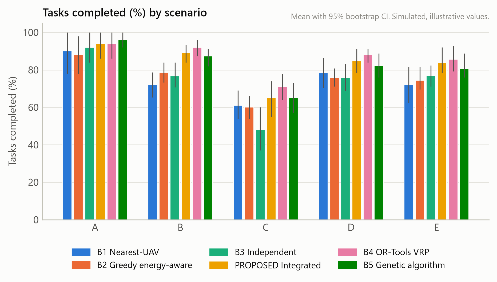

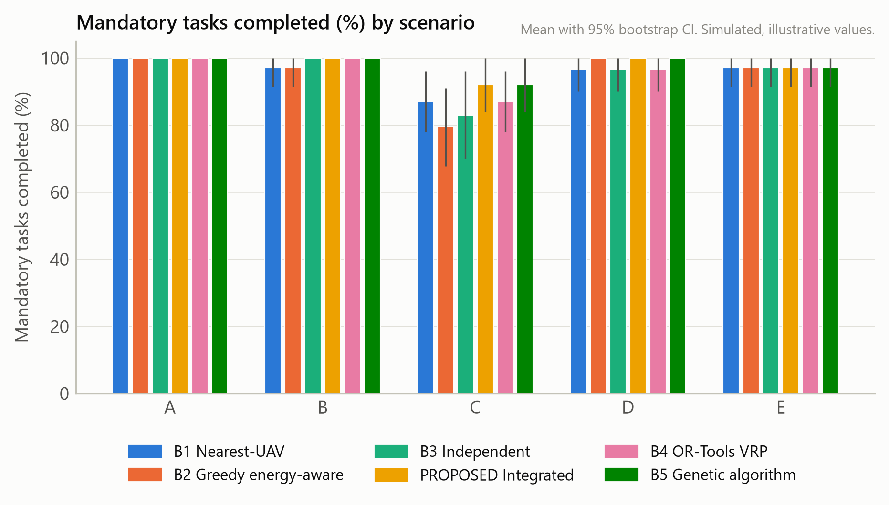

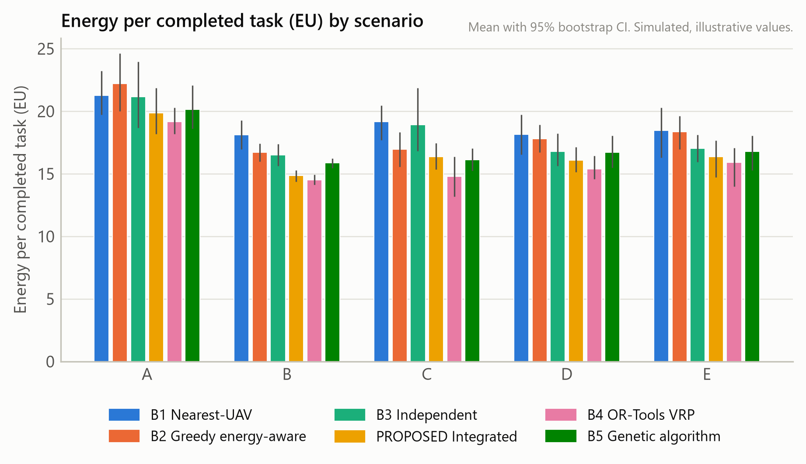

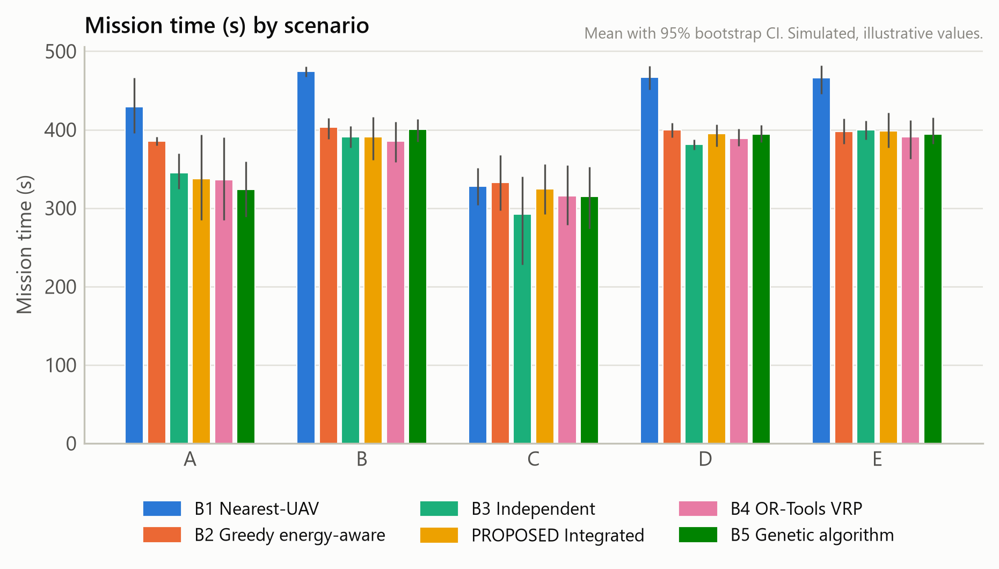

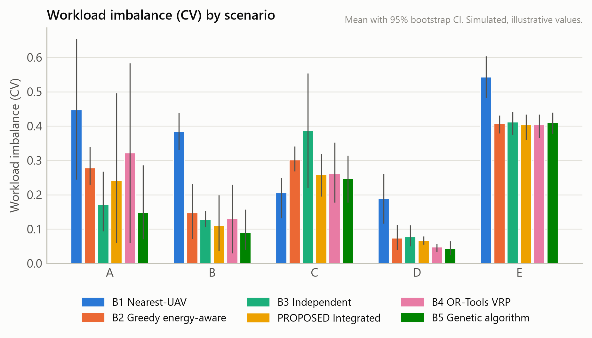

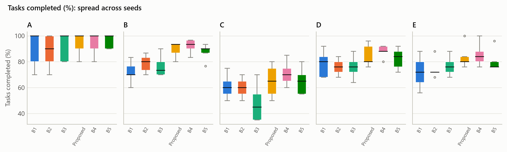

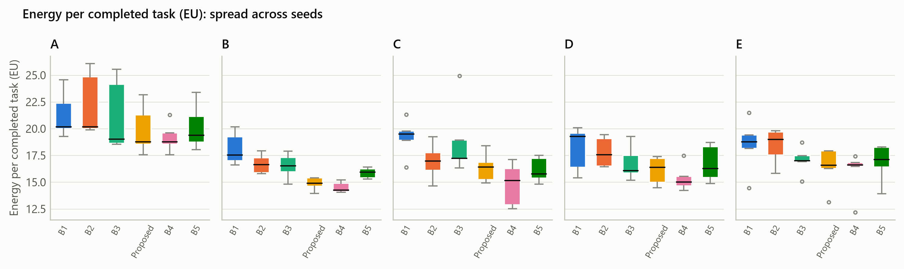

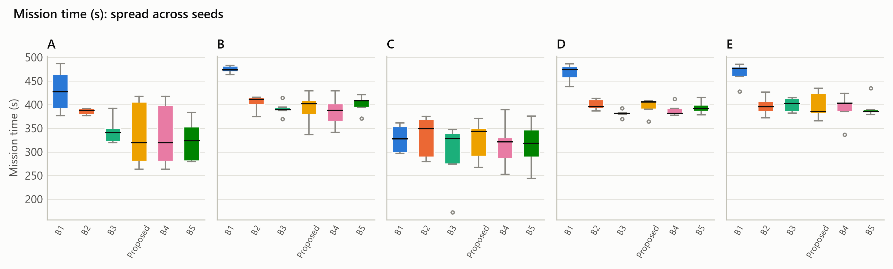

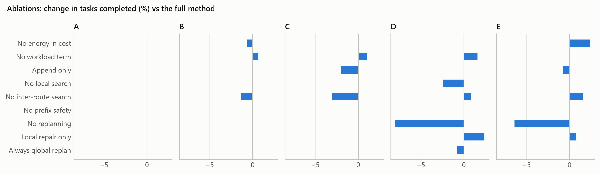

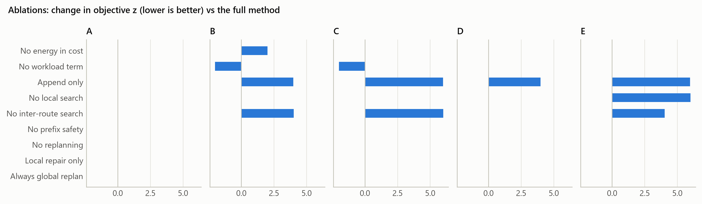

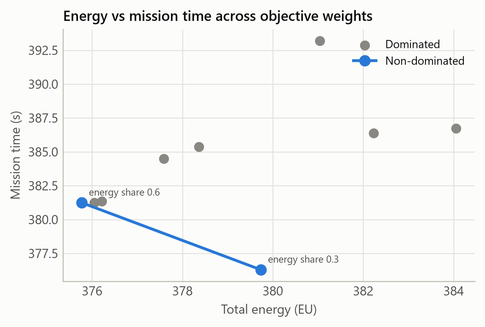

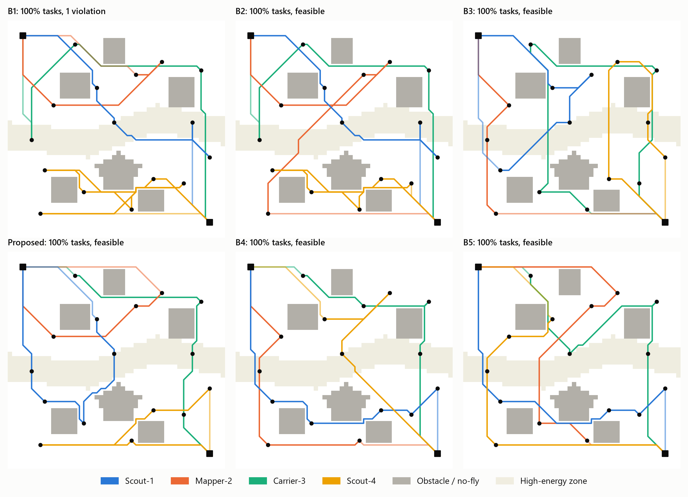

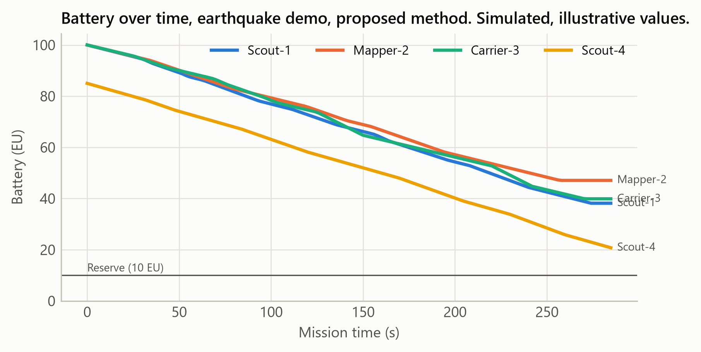

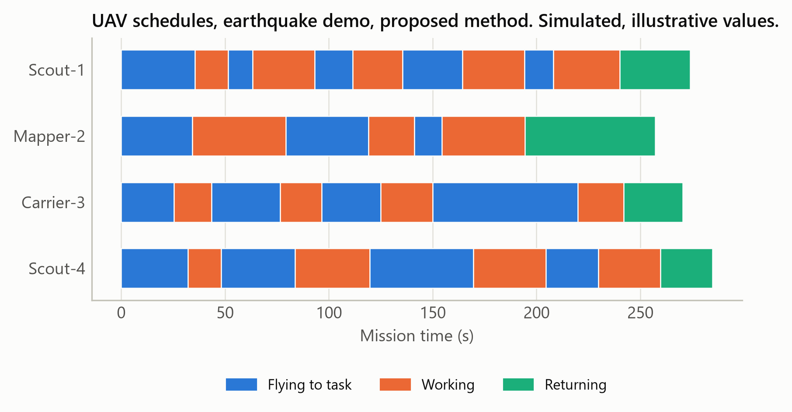

---
Metric definitions: plan_plan_feasible, sim_completion_rate, sim_completion_rate_mandatory, sim_completion_rate_weighted, sim_energy_feasibility_rate, sim_min_battery_margin are higher-is-better; the rest are
lower-is-better. Protocol: `docs/EXPERIMENTS.md`.
